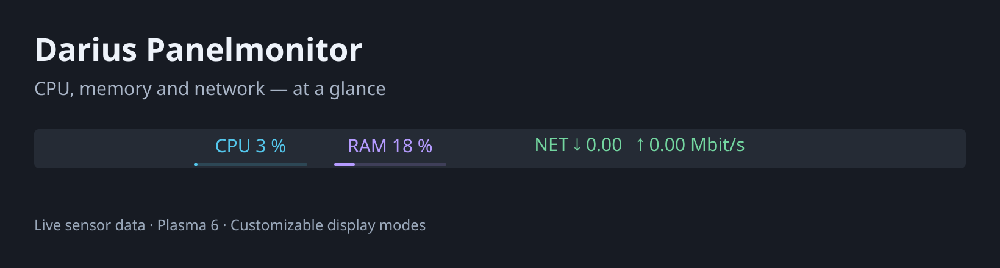
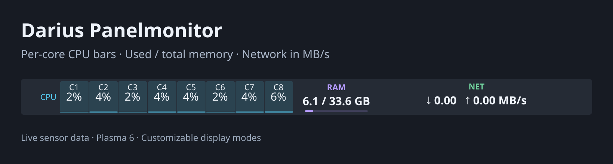
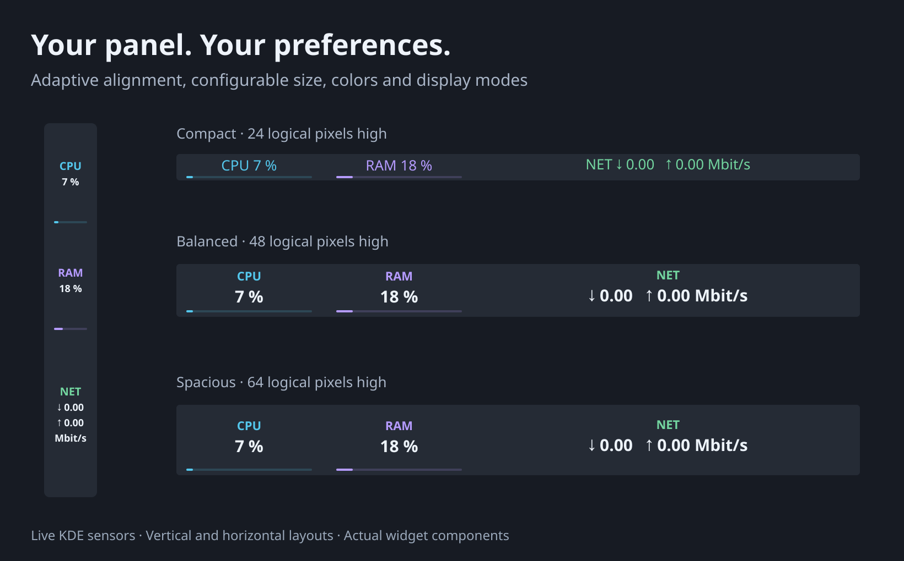

# Darius Panelmonitor

**CPU, memory and network — at a glance.**

A compact, configurable monitor for KDE Plasma 6 panels. See total CPU
usage, used memory, and live download/upload rates together, with optional usage
bars and colors you can change to match your desktop.



## Features

- CPU total percentage or one live bar for each logical CPU (including SMT threads).
- RAM percentage, used memory, or **used / total**, in GiB or decimal GB.
- Network modes: **Mbit/s**, **kbit/s**, **MB/s**, **KiB/s**, or automatic byte units.
- A visible **NET** label in every language and layout.
- Horizontal and vertical panel layouts. Horizontal panels switch to one row
  below 40 logical pixels of available height; larger ones use two rows.
- Text remains centered and scales down to fit the available panel thickness.
- Configurable maximum font size, panel length, colors, usage bars and visible sections.
- Update throttling from 1 to 10 seconds; actual sampling is controlled by KDE.
- Automatic connected Ethernet selection, falling back to connected Wi-Fi.
- Manual interface override, including VPN/tunnel interfaces if KDE exposes sensors.
- English UI with a German translation.
- Native KDE sensors: no shell polling, no additional custom daemon, no telemetry.

## Requirements and compatibility

KDE Plasma **6**, the `org.kde.ksysguard.sensors` QML module, Kirigami, QtQuick
Controls/Dialogs, and the Plasma NetworkManager QML module. On Kubuntu the two
sensor/network packages are `qml6-module-org-kde-ksysguard` and `plasma-nm`.
The shared `ksystemstats` service supplies data and may be activated by the widget.
Python is only used by the development tests; it is not a runtime dependency.

Tested on **Kubuntu 26.04.1 / Plasma 6.6.6 / Qt 6.10.2**, using real KDE sensor data.
Other Plasma 6 environments have not been independently tested. Plasma 5 is not supported. The tested layout matrix is documented below; extreme
combinations can require a longer widget or a smaller font.

## Install

Download the [installable package](dist/Darius-Panelmonitor-1.2.1.plasmoid) and run:

```bash
kpackagetool6 --type Plasma/Applet --install Darius-Panelmonitor-1.2.1.plasmoid
```

For an existing installation, replace `--install` with `--upgrade`. Alternatively,
use Plasma's **Install Widget From Local File** option. Add **Darius Panelmonitor**
to your panel through **Edit Mode → Add Widgets**, then move it near your system
tray. This is a separate panel widget, not an icon inside the system tray.

Right-click the widget and choose **Configure Darius Panelmonitor** to adjust it.
If an update leaves an old copy visible, log out and back in to reload QML safely.

## Make it yours

Open the widget settings to choose **CPU mode**, **Memory mode**, **Memory unit**
and **Network unit**. Layout, maximum text size, length along the panel, visible
sections, usage bars, colors, interface and refresh limit can be set independently.
The panel controls the widget's thickness: your chosen font size is a maximum,
so making a panel thinner does not force text outside it. The length setting
controls width in a horizontal panel and height in a vertical panel.

Per-core mode shows one bar per logical CPU. Percentages appear within the bars
when there is enough room; hover a bar for its CPU number and percentage. On a
many-core system, allocate more panel length for readable numbers. Core bars are
individual gauges and remain available even if the optional total-usage bars are
turned off. Font fitting may shrink long values; no widget can keep unlimited
numbers readable in arbitrarily small space.




## What the readings mean

CPU is overall usage across all cores. Memory follows KDE's physical-memory
sensors. Network figures are current interface throughput, including local LAN
traffic; they are not an Internet speed test or percentage of your ISP plan.
In fixed-unit network modes, the suffix after upload applies to **both** arrows.
Automatic mode prints the unit for each direction. Mbit/s and kbit/s are decimal
bits; MB/s is decimal bytes; KiB/s and automatic byte units use powers of 1024.
Very small transfers may round to zero in the selected unit.
A dash **—** indicates an unavailable or not-yet-ready sensor, rather than zero.

With an empty interface setting, automatic mode chooses one connected Ethernet
interface, or Wi-Fi if none is connected; ties are resolved by interface name.
It does not determine the system's default route. This avoids summing Docker
bridges and virtual adapters into the physical interface's traffic. For multiple
active links or unusual networking, select the required interface manually.
Enter `all` to sum KDE's network interfaces deliberately; that mode may double-count
container or tunnel traffic. Without NetworkManager, use a manual interface name.

## Remove

Remove the widget from your panel, then run:

```bash
kpackagetool6 --type Plasma/Applet --remove de.darius.panelmonitor
```

## Development and testing

`package/` contains the complete QML source, metadata and custom personal non-commercial license. The German
gettext source is in `translations/de.po`; the compiled catalog ships in the
package. `tests/test-release.py` uses Python 3 and PyQt6 for live-sensor checks and
screenshots, requiring a running KDE user session and NetworkManager.
Run it from this source directory:

```bash
python3 tests/test-release.py
```

It writes render/test outputs to `store/` and temporary files to `work/`.
See `store/TEST-REPORT.md` for the exact tested scope and limitations.

## License

Custom personal non-commercial license — Copyright © 2026 Darius Jakpor. This is an independent widget, not an official
KDE product. KDE, Plasma and Qt are projects and trademarks of their respective
owners.

The code is publicly readable, but this is not an open-source license. Personal
non-commercial use and private modification are allowed. Commercial use, sales
and distribution of modified versions require separate written permission.
Read LICENSE for the actual terms. Acceptance of these custom terms by KDE Store has not
been established.
